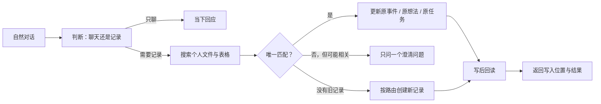
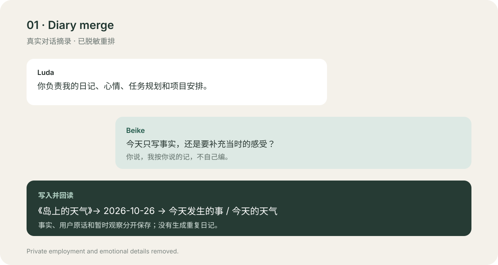
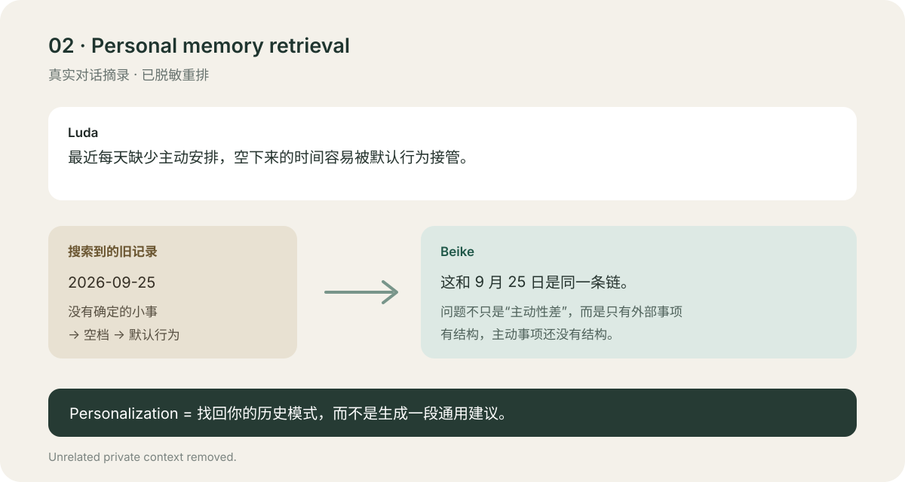
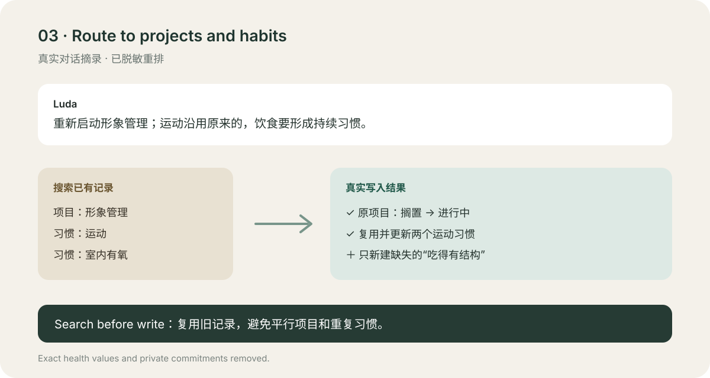

# Beike LifeOS

> I didn't train a model to know me. I connected OpenClaw to the files I already use.

**Beike LifeOS is a lightweight personal agent you can build yourself.**

**Personalization 正在成为 AI 的下一条主线。但你不必等待某个平台更懂你，也不必训练一个专属模型。**

Beike LifeOS 想验证一个更简单的命题：

> **一个通用 Agent，加上一套设计良好的个人文件体系，就足以搭出真正属于你的 Personal Agent。**

贝壳运行在 OpenClaw 上，连接作者原本就在使用的飞书文档和多维表格。它会从自然对话中找到过去的相关内容，理解当前发生了什么，再把信息更新到正确的位置。模型、Agent 框架和存储工具都可以替换；真正长期属于你的，是自己的文件、结构和规则。

这不是另一个要求你迁移全部数据的 AI App，也不是一套沉重的“个人知识库工程”。它是一种**低耦合、可替换、从现有工具开始**的 Personal Agent 搭建方法。

这个仓库提供可以直接交给 Agent 阅读和实施的 **Personal Agent Blueprint**，不包含作者的私人数据。

## 核心观点

### Personalization 不只是模型能力

一个模型是否“懂你”，很大程度取决于它能否：

1. 找到与你当前表达真正相关的过去；
2. 区分临时情绪、长期偏好、项目状态和下一步行动；
3. 把新的信息写回原来的上下文，而不是生成更多碎片；
4. 在不确定时克制地追问，并让用户保留最终控制权。

这些能力不要求训练一个新模型。第一版甚至不一定需要向量数据库：稳定的文件结构、可搜索的标题、明确的路由规则和写后回读，就可以支撑大量真实场景。

### Personal Agent 可以由你自己搭建

最小组合只有三层：

- **OpenClaw**：负责对话、推理和调用工具；
- **你已有的工作空间**：保存日记、想法、项目、任务和习惯；
- **一组个人规则**：定义何时搜索、更新、创建、追问和验证。

不需要把生活交给一个新的封闭平台。更换模型、聊天入口或存储工具时，这套个人结构仍然可以继续使用。

## 贝壳现在能做什么

普通聊天机器人经常只完成眼前这一轮回答。Beike LifeOS 把每次对话放回长期生活脉络中：

- 你的日记、想法、项目、任务和习惯保存在你自己的飞书里；
- Agent 回答前先搜索相关文件和既有记录；
- 同一件事的后续表达回到原位置，而不是不断新建重复内容；
- 用户明确指定目的地时，用户选择优先；
- 找不准时只问一个必要问题，不强行写入；
- 每次写入后回读，只有验证一致才报告成功。

## 一个低耦合的工作方式



## 三个真实案例

以下案例来自真实的个人使用环境，已重新排版并脱敏。没有使用合成演示数据。

### 1. 零散表达合并为同一天的日记



结果：内容进入《岛上的天气》同一天的记录，并被回读确认；没有把一次情绪写成长期人格判断。

### 2. 用过去的文件理解今天



结果：Agent 不是泛泛建议“提高自律”，而是找回过去出现过的同一行为链，解释今天为什么再次发生。

### 3. 将生活目标路由到项目和习惯



结果：更新既有项目，复用既有运动习惯，只创建缺失的饮食习惯；用户说“不进入任务中心”后不再建任务。

## 最小文件体系

你不需要复杂数据库才能开始。第一版只需要这些逻辑资源：

| 资源 | 用途 | 典型写法 |
| --- | --- | --- |
| 日记 | 生活事件、感受与后续变化 | 日期 → 事件 → 后续补充 |
| 想法池 | 尚未成熟但值得继续发展的 idea | 主题 → 初始想法 → 观点演变 |
| 随想笔记 | 阅读、经历和知识带来的个人判断 | 来源 → 我的理解 → 新联系 |
| 项目库 | 有阶段性结果的事情 | 目标、当前进展、下一步 |
| 任务中心 | 一次性且可判断完成的行动 | 动作、日期、状态、所属项目 |
| 习惯中心 | 需要长期重复的行为 | 行为、频率、目标、执行日志 |
| 时间日志 | 已经真实发生的行动 | 做了什么、何时发生、复盘 |

## 交给 Agent 搭建

把这个仓库发给你的 Agent，然后说：

> 请阅读仓库中的 `AGENTS.md` 和 `docs/BUILD_WITH_YOUR_AGENT.md`。先了解我现有的飞书文件和表格，不要新建或修改任何内容。给我一份资源映射和最小实施计划，等我确认后再逐项搭建。

完整流程见 [用你的 Agent 搭建](docs/BUILD_WITH_YOUR_AGENT.md)。

你也可以替换其中任意一层：把 OpenClaw 换成其他能调用工具的 Agent，把飞书换成 Markdown、Notion 或其他可搜索且可写入的工作空间。Beike LifeOS 关心的不是绑定某个产品，而是保留“搜索 → 判断 → 写回 → 验证”这条闭环。

## 设计原则

1. **Search before write**：先找旧内容，再决定更新还是新建。
2. **User destination wins**：用户明确说放哪里，就放哪里。
3. **Conservative by default**：宁可追问，也不自信地写错。
4. **Append and patch**：优先追加和局部更新，不覆写整篇文档。
5. **Read after write**：写完必须回读。
6. **Idempotent operations**：重复消息不产生重复记录。
7. **Private by construction**：密钥、资源 ID 和私人正文永不进入公开仓库。

## 当前边界

- 当前主题匹配采用轻量关键词与字符串相似度，适合个人文件标题稳定、主题相对清晰的场景。
- “我又想到一点”这类完全不包含主题的信息，通常需要追问。
- 多个标题非常相似时，系统不会自动选一个。
- 这是个人系统蓝图，不是面向多租户的 SaaS 产品。

## 仓库结构

```text
.
├── AGENTS.md
├── README.md
├── assets/
│   ├── case-diary.svg
│   ├── case-memory.svg
│   └── case-routing.svg
├── docs/
│   ├── ARCHITECTURE.md
│   ├── BUILD_WITH_YOUR_AGENT.md
│   └── PRIVACY.md
├── examples/
│   └── REAL_CASES_REDACTED.md
└── templates/
    ├── LIFE_ROUTING_POLICY.md
    └── RESOURCE_MAP.example.md
```

## License

MIT. 你可以修改、复用和分享这套方法，但请不要把示例中的真实个人经历还原或重新识别。
