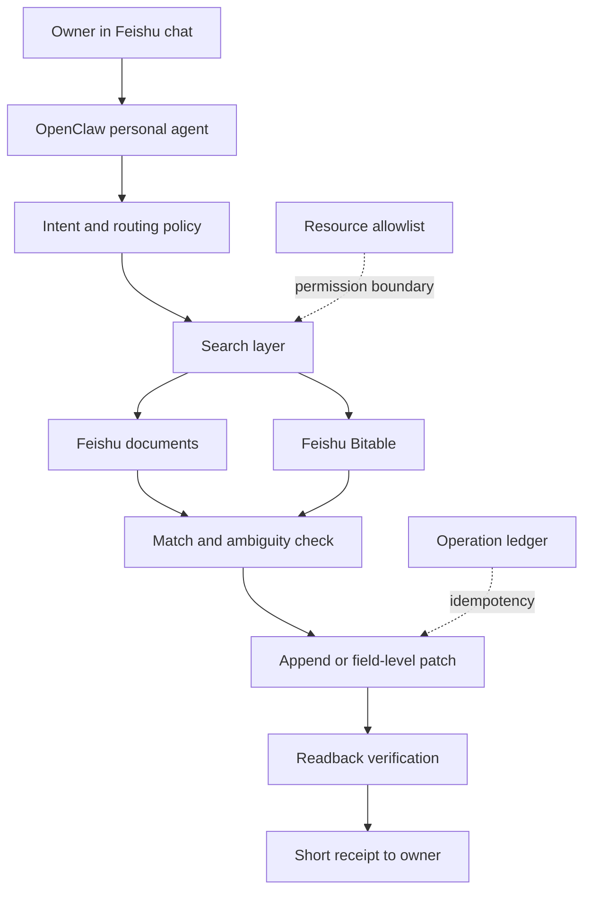

# Architecture

Beike LifeOS is a lightweight personal agent architecture, not a new all-in-one app. It separates conversation, personal context, and durable state so each layer can be replaced independently.

The central claim is simple: useful personalization does not require a custom-trained model or a proprietary memory platform. A capable general agent can become deeply personal when it is connected to well-structured, searchable files and follows conservative read/write rules.

## Responsibilities

### OpenClaw

- Maintains the conversation session.
- Loads the owner's routing and safety policy.
- Chooses which Feishu tools to call.
- Uses searchable files and session context to find relevant prior material.

### Feishu documents

- Hold narrative, evolving material: diary entries, ideas, reflections and principles.
- Preserve chronology and the owner's original language.
- Prefer headings and stable sections that are easy to search.

### Feishu Bitable

- Holds operational state: projects, tasks, habits and actual activity logs.
- Provides record identity and structured fields.
- Remains the source of truth for current status.

### Safe action layer

- Searches before writing.
- Chooses create versus update.
- Rejects ambiguous destinations.
- Adds an operation ID for retry safety.
- Reads the result back before success is reported.

## Matching strategy

Start simple. Stable headings plus normalized keyword/string similarity are often sufficient for a single owner. The fallback is not a more confident guess; it is one clarification question.

Upgrade to embeddings or richer semantic retrieval only when real usage shows repeated misses that cannot be fixed by better headings or explicit references.

## Suggested write levels

| Level | Examples | Default |
| --- | --- | --- |
| R0 | search, read, list schema | Allowed |
| W1 | append a note, create one record | Owner-approved scope |
| W2 | update one existing record | Read old value, patch, read back |
| W3 | bulk update or whole-document rewrite | Confirm every time |
| W4 | delete, move, share, change permissions | Disabled initially |
